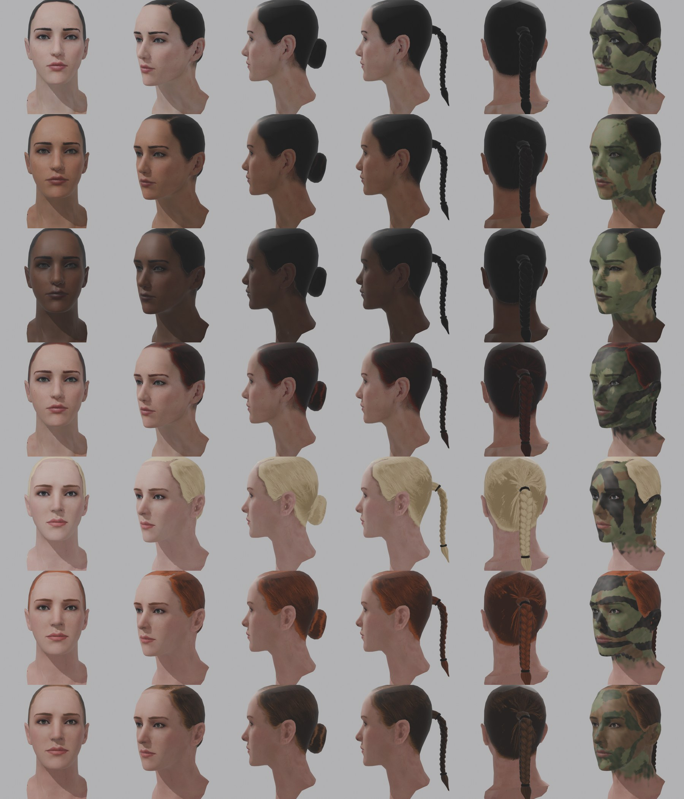

# MH Female Heads

More female characters for Arma 3, built on the female head of
[Task Force Timberwolf Female Characters](https://steamcommunity.com/sharedfiles/filedetails/?id=2021778690) by Iceman.
That mod has to be loaded: normal and ambient maps and the base classes come from it. CBA_A3 is needed as well.

## Faces

Every character comes with a bun or a braid, each also as a "(Tactical)" variant with face paint
(class suffixes `_braid`, `_tac`, `_braid_tac`).

| Class | Name | Look |
|---|---|---|
| `mhfh_kovacs` | Kovacs | black hair, pale skin, grey eyes |
| `mhfh_reyes` | Reyes | dark brown hair, tan skin, brown eyes |
| `mhfh_okoye` | Okoye | black hair, dark skin, dark eyes |
| `mhfh_walsh` | Walsh | auburn hair, fair skin, freckles, green eyes |
| `mhfh_lindqvist` | Lindqvist | platinum blonde, pale skin, blue eyes |
| `mhfh_fraser` | Fraser | ginger hair, fair skin, freckles, green eyes |
| `mhfh_novak` | Novak | light brown hair, hazel eyes |

Pick them in the Arsenal (Face) or with `player setFace "mhfh_walsh"` / `"mhfh_walsh_tac"`.

## Braid and helmets

The braid starts high on the back of the head and comes out through the opening of a baseball cap. Under a
helmet there is no room for it: a character with a braid wears her bun while she has headgear on and gets the
braid back when it comes off (`addons/hair`).

- **Settings** (CBA, "MH Female Heads"): "Bun under helmets" switches this on or off; "Headgear worn with the
  braid" lists the headgear classes the braid fits under (default `H_Cap_red, H_Cap_headphones`, which covers
  all caps; classes that inherit from a listed one count as well).
- **Other mods:** headgear can say so itself with `mhfh_keepBraid = 1;` in its `CfgWeapons` class. A face of
  another mod takes part with `mhfh_bunFace = "<face without the braid>";` in its `CfgFaces` class.

## How they are made

`tools/ref_tftw.py` reads the Timberwolf files from the Steam Workshop folder into `tools/ref` (not in this
repository). `tools/characters.py` then writes everything in `addons/heads`:

- **Textures:** one of the two Timberwolf faces with a new skin tone, brow and eye colour and optional freckles
  (`tools/tftw_masks.py` finds skin, hair, brows, lips and iris in their texture layout). The hair of every
  character is the photographed hair of the dark-haired Timberwolf face with its soft hairline, recoloured;
  on the other face the own blonde hair is replaced by skin first. On the braid variant the hair runs to the
  start of the braid instead of to the bun (`hair_to_braid`). The Tactical variant gets an own camouflage paint
  per character (`face_paint`: stripes or blotches in two or three colours over face, ears and neck). The iris keeps the light and dark of the photographed one and only changes its tint.
  The texture for arms and legs gets the tone of the neck and uses the same shader as the face
  (`mhfh_hl.rvmat`), so both have the same colour where they meet.
- **Models:** the Timberwolf head with a slightly different face shape per character (jaw, chin, nose, cheeks,
  lips, brow). Skull, ears, neck, eye region, UVs and bone weights stay as they are, so helmets, uniforms and the
  face animations behave exactly like on the original head. For the braid variant the bun is taken off and a
  braid is added (`tools/braid.py`): gathered hair, a hair tie, three strands plaited around each other, a second
  tie and the loose end, weighted to head, neck and upper spine.
- **Shadow:** `tools/shadow.py` repairs the shadow volume of the Timberwolf head, which throws dark streaks on
  the neck: three triangles that exist twice are removed, the points below the jaw get the bone weights of the
  visible surface next to them, and points outside the visible surface are moved inside.
- **Config:** `config.cpp` and the model classes in `model.cfg`.

Add a character by adding an entry to `CHARS` in `tools/characters.py` and running it.

## Checks without starting the game

- `tools/simulate.py` replays the vanilla face animations (binarized RTMs from `characters_f\heads\anim`, read by
  `tools/rtm.py`) on a binarized model taken from the built PBO (`tools/pbox.py`, `tools/odump.mjs`). The new heads
  move like the Timberwolf head (viseme A: 9.9 mm on both).
- `tools/preview_data.py` takes the binarized models out of the built PBO (and prints their skeleton);
  `blender -b --python tools/blender/sheet.py -- "" _braid _tac _braid_tac` renders all characters from them
  without opening Blender, `tools/preview_sheet.py` puts the picture above together.

## Credits

- Head model and face textures: Task Force Timberwolf Female Characters by Iceman.
- Skeleton in `model.cfg`: Arma 3 Samples, Bohemia Interactive.
